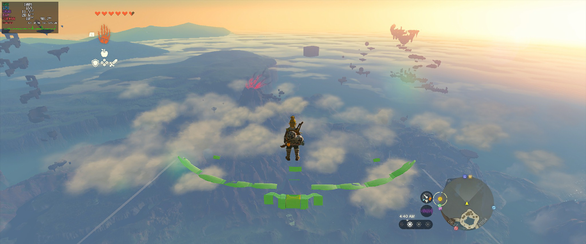
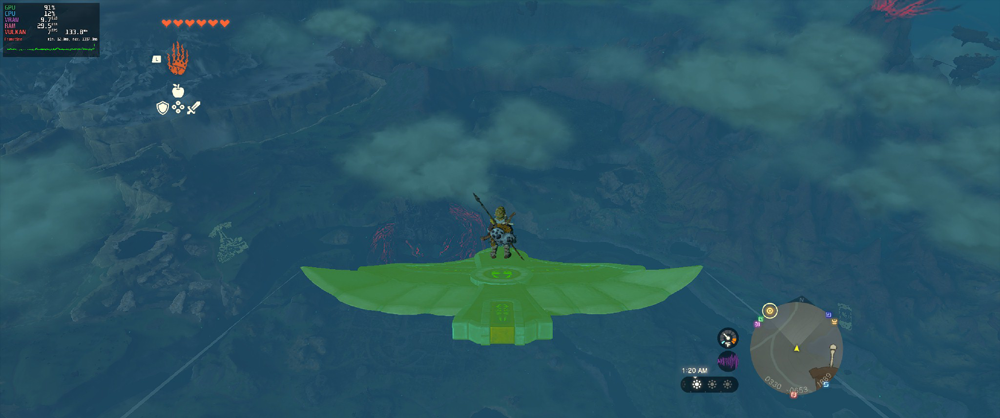
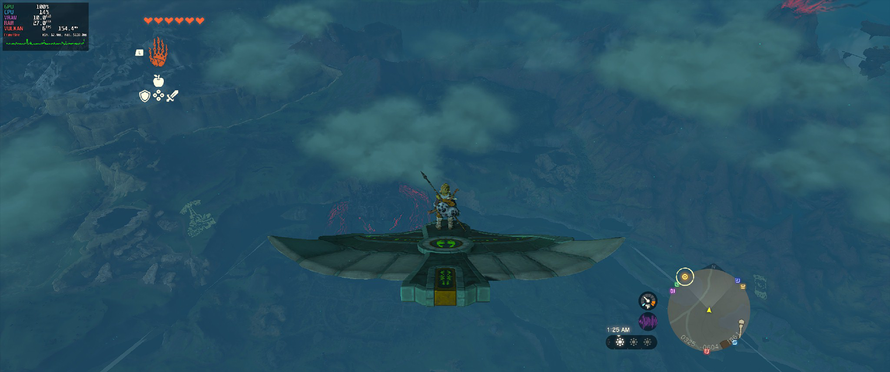

# Experimental rendering candidates for issue #33

The terrain and compute changes are opt-in and intended for comparison testing,
including Windows. The 3D mip assembly correction is enabled by default.
They are not a complete texture-ownership or GPU-memory fix.

## Build and enable

Build this branch using the README's normal instructions. Use a separate checkout
and a copy of your saves. If reusing an already lifted build, the renderer itself
can be rebuilt with:

```text
python a64-kit/build.py native totk --build build --wgpu third_party/wgpu-native
```

This command updates the native executable under `build/totk/native`; it does not
update a previously packaged executable under `dist`. Run/copy the rebuilt native
executable with the matching runtime files as described in the README. No game
re-lift is required by this renderer-only change. The top-level packaging script
may require a fresh build directory when its source fingerprint changes.

For a newly packaged Windows build, open PowerShell in `dist/SkyboundTOTK`:

```powershell
$env:RX_CPU_READ_COMPUTE_STREAM = "1"
$env:RX_REJECT_TERRAIN_FORMAT_ALIAS = "1"
$env:RX_REJECT_TERRAIN_MATERIAL_ALIAS = "1"
$env:RX_STATS = "1"
.\SkyboundTOTK.exe *> rendering-test.log
```

On Linux, from the corresponding packaged directory:

```sh
RX_CPU_READ_COMPUTE_STREAM=1 RX_REJECT_TERRAIN_FORMAT_ALIAS=1 \
RX_REJECT_TERRAIN_MATERIAL_ALIAS=1 RX_STATS=1 \
./SkyboundTOTK > rendering-test.log 2>&1
```

All three experimental switches default off. Unset them for a baseline run or
set them to `0`. Restart between comparisons; the terrain switches are cached.
The environment variables above apply to launches from that shell, not to a
separate Steam/Heroic launch. Optional fullscreen/ultrawide settings are unchanged.

## What changes

- 3D render-target assembly now copies each mip level and its shrinking depth
  slices, using that level's guest address and tracking versions per mip/slice.
  Previously only level zero was assembled, leaving GPU-rendered lower mips
  absent from the sampled volume. This correction needs no environment flag.

- `RX_REJECT_TERRAIN_FORMAT_ALIAS`: for 260x260 R16 height maps, bypass an old
  rendered RG8 image at the same guest address and use the existing decode path.
- `RX_REJECT_TERRAIN_MATERIAL_ALIAS`: equivalent narrow guard for 260x260 RGBA8
  material maps shadowed by old RG8 targets. Neither guard deletes the target or
  claims that every cross-format view is invalid.
- `RX_CPU_READ_COMPUTE_STREAM`: remember small CPU-observed page ranges on mapped
  invalidation/readback. Later compute dispatches writing an overlapping range
  through a single storage descriptor use the existing stream/writeback path.
  Copy cached GPU contents into the stream before dispatch, then copy results
  back into the cache, preserving other GPU consumers and unwritten contents.
  This does not synchronously stall at every invalidation.

The CPU range hints retain the first 16 distinct page-rounded ranges up to
256 KiB each. They are not allocation identities; address reuse can produce false
positives, and further ranges are not tracked once full. Multi-descriptor
compute dispatches are intentionally excluded because descriptors may alias.
The web invalidation entry point remains unchanged in behaviour.

## Evidence and limits

Issue #33 contains RenderDoc screenshots and detailed tracing. In one traced
case, finalised RG8 image 3835 at 0x7e625000 was selected for replacement RGBA8
serial 70578. A controlled follow-up with the same binary, save source and route
but the material guard enabled selected newly decoded RGBA8 instead. Timing and
allocation addresses differed: this was not a pixel-matched A/B capture.

With the combined candidates, the reporter has not observed the previously
reported stretched terrain ("waterfalls"), camera-dependent disappearing terrain
or corrupted material sheets across recent play sessions. Scope/zoom blur also
appeared improved, but its cause has not been isolated.

Those play builds include other local experiments, notably wider guest address
space and the separate Game Over fix. They are not clean upstream-only controls.
This PR deliberately excludes those changes, Linux/debugger instrumentation,
the torch lifter fix, speculative explicit uploads, and prefetch experiments.
The CPU range hint bookkeeping is extracted from the disabled-prefetch machinery
into a small standalone class, retaining its cap, page alignment and overlap rules.

Windows gameplay is not yet verified. Linux compilation and the range test below
cover the extracted branch; the prior long-session observations concern the
combined local build, not a completed long-session test of this exact branch.
A focused real-GPU compute/writeback regression remains needed.

Known remaining problems:
- Water/fog/reflections can still appear or disappear with camera angle, documented
  in the long session on November 8. A saved cave location is available locally.
- Effect alignment (fan thrust and spawned device glue), as described in #30,
  remains unresolved; these changes do not claim to fix it.
- VRAM usage still builds up during exploration. It *seems* to take longer to
  fill in recent sessions, but duration, route, idle breaks and other local
  changes differ. This is an observation, not a measured improvement or leak fix.
  One almost-six-hour open session included about two hours idle and breaks.
- Intermittent bad guest-pointer crashes, frequently encountered while using
  Ultrahand or other abilities, remain. The abilities usually work; the trigger
  conditions and relation to memory growth are not established.

## Useful test reports

Include branch commit, OS/GPU/driver, enabled switches, game version, active play
versus idle time, resolution, and whether RenderDoc was loaded. Note which visual
symptom changed and when, approximate VRAM progression, FPS, and the last log
lines on failure. Compare the same save/route/camera where possible. Testing one
switch at a time helps attribute improvements or regressions.

## Small standalone range test

No game data or GPU required:

```sh
clang++ -std=c++20 tests/cpu_read_ranges.cpp -o cpu_read_ranges
./cpu_read_ranges
```

It covers page rounding, overlap endpoints, duplicate registration, capacity,
size limits and overflow rejection. It does not validate GPU scheduling or visual
correctness. Runtime `RX_STATS=1` exposes `cpu_read_compute_streams`; alias-guard
logs use `[TERRAIN-ALIAS-TEST]` and `[TERRAIN-MATERIAL-TEST]` when exercised.

## 3D volume mip regression and flight test

```sh
python3 tests/texture_3d_mip_assembly.py
```

Requires Python 3 and a C++20 compiler named `c++` with AddressSanitizer and
UndefinedBehaviorSanitizer. The test extracts the actual assembly function from
`rx_texture.cpp` and runs it with mocked image lookup and GPU copy recording.
It verifies mip/slice destinations, shrinking dimensions, per-slice updates,
unchanged passes, missing/mismatched sources, and single-level/non-cubic volumes.
Layout offsets are stubbed: this test does not validate the layout calculator
or GPU execution. The original function fails: expected 63 mip/slice copies for
a 32x32x32 six-level volume, got 32. The corrected function passes. LeakSanitizer
is disabled in this harness; address and undefined-behaviour checks remain on.

In a captured failing Zonai wing expiry frame, pixel history identified shader
discard at a missing wing section. A sampled 32x32x32 RGBA8 noise volume had data
in mip 0 but zero-filled mips 1 through 5. A replay-only diagnostic forcing that
noise sample to mip 0 restored most missing geometry; this override is NOT part
of the patch.

With the assembly correction in the combined local Linux build, a player flew a
wing through the warning animation and captured the pre-warning, green, and
regular-colour warning phases. The entire wing remained visible. Replay of the
green-phase capture confirmed an identical mip-0 SHA256 to the original volume
and populated mips 1 through 5. Red-channel ranges were 35..239, 60..192, 90..157,
127..127 and 123..123 respectively, versus all zero before. This is one successful
flight test on RX 9070 XT; Windows and broader effects remain unverified.





These are different flights/cameras, not pixel-aligned before/after frames.
Raw captures and game assets are not included.
